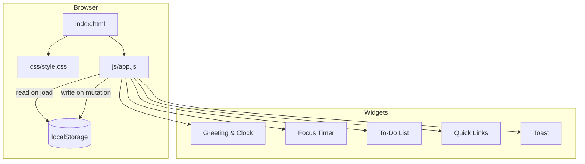

# Design Document

## Overview

The Todo List Life Dashboard is a client-side single-page application (SPA) built with plain HTML, CSS, and Vanilla JavaScript. It delivers four productivity widgets — a greeting/clock header, a Pomodoro focus timer, a to-do list, and a quick-links launcher — in a single self-contained web page. All state persists exclusively in the browser's `localStorage`. There is no build step, no package manager, no test runner preinstalled, and no backend.

**Design goals:**
- Zero external runtime dependencies (no frameworks, no CDN JS libraries).
- All features work offline after the first page load.
- The codebase is confined to three files: `index.html`, `css/style.css`, and `js/app.js`.
- Security-by-default: every user-supplied string is HTML-escaped before DOM insertion; only `http://` and `https://` URLs are allowed in `href` attributes.

---

## Architecture

The application follows a simple **data-first, event-driven** pattern:

1. **State** — Each widget owns a small in-memory array or scalar (e.g., `tasks[]`, `links[]`, `timerRemaining`).
2. **Persistence** — After every mutation, the state is serialized to `localStorage` via a thin `getLS` / `setLS` wrapper.
3. **Rendering** — Each widget has a dedicated `render*()` function that rebuilds its DOM node list from the current in-memory state. Renders are cheap because each widget manages a small, bounded list.
4. **Events** — Native DOM event listeners (form `submit`, button `click`, `change`, `keydown`) call mutation functions, which update state, persist, and trigger a render.
5. **Timers** — The clock uses `setInterval` at 1 s. The Pomodoro countdown uses a separate `setInterval` that is cleared and recreated on start/stop/reset.



**Key design decisions:**

| Decision | Choice | Rationale |
|---|---|---|
| Persistence | `localStorage` only | No backend required; survives page refresh; sufficient for a personal dashboard |
| Rendering | Full re-render per widget on change | Simplest correct approach for small lists; avoids diff/reconciliation complexity |
| Security | Manual HTML escaping | No framework sanitizer available; a small, reviewable `escapeHtml` function is auditable |
| Timer mechanism | `setInterval` (1 s) | Standard browser API; sufficient precision for a Pomodoro timer |
| Theme | CSS custom properties + `data-theme` on `<html>` | A single attribute toggle drives the full color scheme without JS-managed class lists |

---

## Components and Interfaces

### 1. LocalStorage Helpers

```
getLS(key: string, fallback: any) → any
  Reads and JSON-parses localStorage[key]. Returns fallback on missing key or parse error.

setLS(key: string, value: any) → void
  JSON-serializes value and writes it to localStorage[key].
```

**localStorage keys used:**

| Key | Type | Default |
|---|---|---|
| `theme` | `"light" \| "dark"` | `"light"` |
| `pomodoroDuration` | `number` (1–120) | `25` |
| `tasks` | `Task[]` | `[]` |
| `quickLinks` | `Link[]` | `[]` |

---

### 2. Greeting & Clock

**DOM targets:** `#greeting`, `#datetime`

```
getGreetingText(hour: number) → string
  Maps the current hour to one of four greeting strings:
    05–11 → morning
    12–16 → afternoon
    17–20 → evening
    21–04 → night

updateClock() → void
  Reads the current local time, calls getGreetingText, and sets the
  textContent of #greeting and #datetime.
  Called once at load, then by setInterval every 1000 ms.
```

---

### 3. Theme Toggle

**DOM targets:** `#themeToggle`, `<html data-theme="...">`

```
applyTheme(theme: "light" | "dark") → void
  Sets data-theme on <html>, persists to localStorage["theme"].

Event: #themeToggle click → toggles between "light" and "dark".
```

CSS hides the sun/moon icon using `[data-theme="light"] .icon-moon { display: none }` and the inverse, so no JS class management is needed for icon visibility.

---

### 4. Focus Timer

**DOM targets:** `#timerDisplay`, `#timerRing`, `#timerStart`, `#timerStop`, `#timerReset`, `#pomodoroMinutes`, `#pomodoroSet`

**State (module-level variables):**

```
timerDuration:   number   — total seconds for the current session
timerRemaining:  number   — seconds left in the current countdown
timerRunning:    boolean  — whether the interval is active
timerInterval:   number   — handle returned by setInterval
```

**Ring animation:** The SVG `<circle>` has `stroke-dasharray = 2π × 52 ≈ 326.73`. The `stroke-dashoffset` is set to `circumference × (1 − remaining / duration)`, producing a clockwise drain effect. The `.low` CSS class switches the stroke color to `--clr-danger` when `timerRemaining ≤ 60` and the timer is running.

```
formatTime(seconds: number) → "MM:SS"

updateTimerUI() → void
  Updates #timerDisplay text and timerRing stroke-dashoffset.
  Applies/removes the .low class.

startTimer() → void
  No-op if already running. Sets timerRunning = true, starts interval.

stopTimer() → void
  Clears interval, sets timerRunning = false, removes .low class.

resetTimer() → void
  Calls stopTimer(), restores timerRemaining = timerDuration, calls updateTimerUI().
```

**Custom duration flow:**
1. User enters a value in `#pomodoroMinutes` and clicks `#pomodoroSet`.
2. The value is parsed as an integer. If outside 1–120, `showToast` is called and the duration is unchanged.
3. Otherwise, `stopTimer()` is called, `timerDuration` and `timerRemaining` are updated, the new duration is persisted to `localStorage["pomodoroDuration"]`, and `updateTimerUI()` is called.

---

### 5. To-Do List

**DOM targets:** `#todoForm`, `#todoInput`, `#todoList`, `#todoEmpty`, `#sortSelect`, `#editModal`, `#editInput`, `#editSave`, `#editCancel`

**Task data model:** see Data Models section.

```
saveTasks() → void
  Writes tasks[] to localStorage["tasks"].

getSortedTasks() → Task[]
  Returns a shallow copy of tasks[] sorted according to #sortSelect.value:
    "default" → insertion order (no sort)
    "az"      → localeCompare ascending
    "za"      → localeCompare descending
    "done"    → incomplete first (Number(a.done) - Number(b.done))
    "undone"  → complete first (Number(b.done) - Number(a.done))

renderTasks() → void
  Clears #todoList, iterates getSortedTasks(), creates <li> elements,
  attaches inline event listeners, appends to list. Toggles #todoEmpty.

addTask(text: string) → void
  Called on todoForm submit. Trims input; no-ops on empty. Pushes
  { id: Date.now(), text, done: false } to tasks[], calls saveTasks()
  and renderTasks(). Clears and focuses #todoInput.
```

**Edit modal:**

```
openEditModal(task: Task) → void
  Sets editingTask reference, populates #editInput, removes hidden from #editModal.

closeEditModal() → void
  Clears editingTask, sets #editModal hidden.

saveEdit() → void
  Trims #editInput value; no-ops on empty. Mutates editingTask.text,
  calls saveTasks(), renderTasks(), closeEditModal().
```

Modal close triggers: Cancel button click, backdrop click, `Escape` key.
Modal save triggers: Save button click, `Enter` key while modal is open.

---

### 6. Quick Links

**DOM targets:** `#linkForm`, `#linkName`, `#linkUrl`, `#linkList`, `#linksEmpty`

**Link data model:** see Data Models section.

```
saveLinks() → void
  Writes links[] to localStorage["quickLinks"].

getFavicon(url: string) → string
  Extracts the origin from the URL and returns a Google favicon service URL.
  Returns "" on parse error.

renderLinks() → void
  Clears #linkList, creates .link-chip elements with favicon ,
  attaches delete listeners. Toggles #linksEmpty.

addLink(name: string, url: string) → void
  Called on linkForm submit. Prepends "https://" if url lacks a protocol.
  Pushes { id: Date.now(), name, url } to links[], calls saveLinks() and renderLinks().
```

---

### 7. Toast Notifications

**DOM targets:** `#toast`, `#toastMsg`

```
showToast(message: string, duration = 2800) → void
  Sets #toastMsg.textContent, removes hidden from #toast, clears any
  pending timer, starts a new timer:
    after duration ms → adds .fade-out class
    after additional 420 ms → sets hidden = true
  Re-entrant: calling showToast while a toast is visible replaces the
  message and resets the timer.
```

The `.fade-out` CSS class applies `opacity: 0` with a 0.4 s transition, providing a smooth dismissal animation.

---

### 8. Security Helpers

```
escapeHtml(str: string) → string
  Replaces & → &amp;, < → &lt;, > → &gt;, " → &quot;, ' → &#39;.
  Applied to all task labels and link names before DOM insertion.

escapeAttr(str: string) → string
  Wraps escapeHtml. If str does not begin with http:// or https://,
  substitutes "#". Used for href attributes on link chips.
```

---

### 9. Responsive Layout

CSS Grid with `grid-template-columns: repeat(auto-fit, minmax(320px, 1fr))` on `.dashboard` handles multi-column layout automatically above 601 px. A `@media (max-width: 600px)` block reduces padding, collapses the Quick Links form to two columns, and enlarges the timer display.

---

## Data Models

### Task

```
interface Task {
  id:   number;   // Date.now() at creation — used as a unique identifier
  text: string;   // User-supplied label; 1–120 characters; HTML-escaped on render
  done: boolean;  // false = incomplete, true = complete
}
```

**Storage key:** `"tasks"` → `Task[]`

### Link

```
interface Link {
  id:   number;   // Date.now() at creation
  name: string;   // Display label; 1–30 characters; HTML-escaped on render
  url:  string;   // Absolute URL; always begins with http:// or https://
}
```

**Storage key:** `"quickLinks"` → `Link[]`

### Theme

```
type Theme = "light" | "dark";
```

**Storage key:** `"theme"` → `Theme`

### Pomodoro Duration

```
type PomodoroDuration = number; // integer, 1–120 (minutes)
```

**Storage key:** `"pomodoroDuration"` → `PomodoroDuration`

---

## Correctness Properties

*A property is a characteristic or behavior that should hold true across all valid executions of a system — essentially, a formal statement about what the system should do. Properties serve as the bridge between human-readable specifications and machine-verifiable correctness guarantees.*

### Property 1: Greeting function covers all 24 hours

*For any* integer hour in the range 0–23, `getGreetingText(hour)` SHALL return a non-empty string. Hours 5–11 SHALL return the morning greeting, 12–16 the afternoon greeting, 17–20 the evening greeting, and hours 0–4 and 21–23 SHALL all return the same night greeting.

**Validates: Requirements 1.3, 1.4, 1.5, 1.6**

### Property 2: Theme persistence round-trip

*For any* theme value in `{"light", "dark"}`, calling `applyTheme(theme)` and then reading `localStorage["theme"]` SHALL return a value strictly equal to the applied theme.

**Validates: Requirements 2.2, 2.3**

### Property 3: Timer format is always MM:SS

*For any* integer number of seconds in the range 0–7200, `formatTime(seconds)` SHALL return a string matching the pattern `^[0-9]{2}:[0-9]{2}$`.

**Validates: Requirements 3.2, 3.3, 3.4**

### Property 4: Timer reset restores full duration

*For any* valid Pomodoro duration (1–120 minutes expressed in seconds), after calling `resetTimer()`, `timerRemaining` SHALL equal `timerDuration` and `timerRunning` SHALL be `false`.

**Validates: Requirements 3.4**

### Property 5: Low-time warning is applied at or below 60 seconds while running

*For any* `timerRemaining` value in the range 0–60 while `timerRunning` is `true`, calling `updateTimerUI()` SHALL apply the `.low` CSS class to the timer ring element. *For any* `timerRemaining` value above 60, the `.low` class SHALL NOT be present.

**Validates: Requirements 3.6**

### Property 6: Pomodoro duration persistence round-trip

*For any* integer duration value in the range 1–120, after the user sets that value, `localStorage["pomodoroDuration"]` SHALL equal that integer.

**Validates: Requirements 3.9, 3.10**

### Property 7: Adding a valid task grows the list by one with done=false

*For any* task array and any non-whitespace string of 1–120 characters, adding that string SHALL increase the array length by exactly one, and the new task's `done` field SHALL be `false`.

**Validates: Requirements 4.1**

### Property 8: Whitespace-only task descriptions are rejected

*For any* string composed entirely of Unicode whitespace characters, attempting to add it as a task SHALL leave the task array unchanged (same length and same contents).

**Validates: Requirements 4.1**

### Property 9: Edit saves the new label

*For any* task object and any non-empty replacement string, after the edit modal is saved with that string, the task's `text` field SHALL equal the trimmed replacement string.

**Validates: Requirements 4.3**

### Property 10: Cancel discards changes

*For any* task object, opening the edit modal with a modified value in the input and then calling `closeEditModal()` without saving SHALL leave the task's `text` field unchanged from its value before the modal opened.

**Validates: Requirements 4.4**

### Property 11: Completion toggle is its own inverse

*For any* task object with an initial `done` value, toggling the completion state twice SHALL return `done` to its original value.

**Validates: Requirements 4.5**

### Property 12: Delete removes the targeted task by id

*For any* task array containing at least one task, deleting a task by its `id` SHALL produce an array in which no task with that `id` exists, and all other tasks are present and unchanged.

**Validates: Requirements 4.6**

### Property 13: Task persistence round-trip

*For any* array of task objects, serializing via `saveTasks()` and deserializing `localStorage["tasks"]` SHALL produce an array where every task's `id`, `text`, and `done` fields are equal to the originals.

**Validates: Requirements 4.7, 4.8**

### Property 14: getSortedTasks does not mutate the source array

*For any* task array and any sort mode, calling `getSortedTasks()` SHALL NOT change the order or contents of the original in-memory `tasks` array.

**Validates: Requirements 5.7**

### Property 15: Sorted view contains exactly the same tasks as the source

*For any* task array and any sort mode, the array returned by `getSortedTasks()` SHALL contain exactly the same task `id` values as the source array — no tasks added or removed.

**Validates: Requirements 5.1, 5.2**

### Property 16: Locale sort order is correct in both directions

*For any* task array sorted by `"az"`, every adjacent pair `(a[i], a[i+1])` SHALL satisfy `a[i].text.localeCompare(a[i+1].text) <= 0`. *For any* task array sorted by `"za"`, every adjacent pair SHALL satisfy `a[i].text.localeCompare(a[i+1].text) >= 0`.

**Validates: Requirements 5.3, 5.4**

### Property 17: Done-sort partitions tasks correctly

*For any* task array sorted by `"done"` (done-last), all tasks with `done === false` SHALL precede all tasks with `done === true`. *For any* task array sorted by `"undone"` (done-first), all tasks with `done === true` SHALL precede all tasks with `done === false`.

**Validates: Requirements 5.5, 5.6**

### Property 18: Adding a valid link grows the list by one

*For any* links array and any valid name/URL pair, adding the link SHALL increase the array length by exactly one.

**Validates: Requirements 6.1**

### Property 19: URL auto-prefix always produces an http(s) URL

*For any* URL string, after the auto-prefix logic is applied, the resulting URL SHALL begin with `http://` or `https://`. *For any* URL string that already begins with `http://` or `https://`, applying the prefix logic SHALL leave the URL unchanged (idempotence).

**Validates: Requirements 6.2**

### Property 20: Link delete removes the targeted link by id

*For any* links array containing at least one link, deleting a link by its `id` SHALL produce an array in which no link with that `id` exists, and all other links are present and unchanged.

**Validates: Requirements 6.4**

### Property 21: Link persistence round-trip

*For any* array of link objects, serializing via `saveLinks()` and deserializing `localStorage["quickLinks"]` SHALL produce an array where every link's `id`, `name`, and `url` fields are equal to the originals.

**Validates: Requirements 6.5, 6.6**

### Property 22: HTML escaping eliminates all injection characters

*For any* input string, `escapeHtml(input)` SHALL return a string containing none of the literal characters `&`, `<`, `>`, `"`, or `'` in unescaped form.

**Validates: Requirements 7.1, 7.2**

### Property 23: escapeAttr substitutes unsafe URLs with a safe placeholder

*For any* string that does not begin with `http://` or `https://`, `escapeAttr(str)` SHALL return `"#"`. *For any* string that begins with `http://` or `https://`, `escapeAttr(str)` SHALL return a non-empty string that is NOT `"#"`.

**Validates: Requirements 7.3**

---

## Error Handling

| Scenario | Behavior |
|---|---|
| `localStorage` read error (quota exceeded, private mode restrictions) | `getLS` catches the exception and returns the provided fallback value; the widget renders using in-memory state. |
| `localStorage` write error | `setLS` does not throw; data is held in memory for the session but not persisted. No user-visible error is shown (silent degradation). |
| Invalid Pomodoro duration input | `showToast` displays the valid range (1–120). The duration and timer state are not changed. |
| Empty task or link submission | The form `submit` handler trims the input; if the result is empty, the handler returns early. No new item is added and no error is shown (the `required` attribute on the HTML input provides browser-native validation for completely empty fields). |
| Malformed URL in Quick Links | The `type="url"` input attribute triggers browser-native validation before the form submits. `escapeAttr` provides a second layer of defense at render time. |
| `URL` constructor throws on a favicon request | `getFavicon` wraps the call in try/catch and returns an empty string; the `` tag is omitted. |
| Task or link ID collision | `Date.now()` is used as ID. Collisions are theoretically possible if two items are added within the same millisecond. For a personal dashboard this risk is acceptable; no deduplication logic is needed. |

---

## Testing Strategy

This project has no build toolchain and no test runner configured. Testing uses two complementary approaches: property-based tests for pure functions, and manual/integration tests for DOM-dependent behavior.

### Property-Based Tests (JavaScript)

The pure functions in `js/app.js` are amenable to property-based testing using **fast-check** (loaded from CDN into a separate `tests/pbt.html` file, or run via Node with no bundler).

**Key testable units:**
- `getGreetingText(hour)` — pure, deterministic
- `formatTime(seconds)` — pure, deterministic
- `getSortedTasks()` — pure relative to its inputs
- `escapeHtml(str)` — pure, deterministic
- `escapeAttr(str)` — pure, deterministic
- URL auto-prefix logic (extracted as a pure helper)
- `saveTasks` / `getLS` / `setLS` (with a mocked `localStorage`)

**Property test configuration:**
- Minimum 100 iterations per property test (fast-check default).
- Each test file references its design property with a comment tag:
  `// Feature: todo-life-dashboard, Property N: <property text>`

**Property tests to implement:**

| Property | Generator | Assertion |
|---|---|---|
| 1 — Greeting covers all 24 hours | `fc.integer({min:0, max:23})` | `getGreetingText(h)` is non-empty; hours 0–4 and 21–23 return the night greeting; hours 5–11 return morning; 12–16 afternoon; 17–20 evening |
| 2 — Theme persistence round-trip | `fc.constantFrom("light","dark")` | `applyTheme(t)` → `getLS("theme")` equals `t` |
| 3 — Timer format is MM:SS | `fc.integer({min:0, max:7200})` | `formatTime(s)` matches `/^[0-9]{2}:[0-9]{2}$/` |
| 4 — Reset restores full duration | `fc.integer({min:60, max:7200})` | After `resetTimer()`, `timerRemaining === timerDuration` and `timerRunning === false` |
| 5 — Low-time warning class | `fc.integer({min:0, max:60})` | `updateTimerUI()` with running timer adds `.low` class; integers > 60 do not |
| 6 — Pomodoro duration persistence | `fc.integer({min:1, max:120})` | After setting, `getLS("pomodoroDuration")` equals the set value |
| 7 — Adding valid task grows list | `fc.array(taskArb)` + `fc.string({minLength:1}).filter(s=>s.trim())` | List length increases by 1; new task `done === false` |
| 8 — Whitespace task rejected | `fc.stringOf(fc.constantFrom(' ','\t','\n'))` | Adding leaves list length and contents unchanged |
| 9 — Edit saves new label | `fc.record({id:fc.nat(), text:fc.string(), done:fc.boolean()})` + `fc.string({minLength:1}).filter(s=>s.trim())` | After `saveEdit()`, `task.text === newLabel.trim()` |
| 10 — Cancel discards changes | Same task arbitraries | After `closeEditModal()` without saving, `task.text` unchanged |
| 11 — Toggle is its own inverse | `fc.record({done:fc.boolean(), …})` | Double-toggle returns `done` to original value |
| 12 — Delete removes task by id | `fc.array(taskArb, {minLength:1})` + pick one task | After delete, no task with that `id` in array; all others intact |
| 13 — Task persistence round-trip | `fc.array(taskArb)` | `saveTasks()` → `getLS("tasks")` has same `id/text/done` per task |
| 14 — getSortedTasks non-mutating | `fc.array(taskArb)` + `fc.constantFrom(sortModes)` | Original `tasks` array order unchanged after `getSortedTasks()` |
| 15 — Sorted view has same elements | Same as 14 | Sorted array and original array have identical `id` sets |
| 16 — Locale sort order correct | `fc.array(taskArb, {minLength:2})` | A→Z: adjacent pairs satisfy `localeCompare ≤ 0`; Z→A: `≥ 0` |
| 17 — Done-sort partitions correctly | `fc.array(taskArb)` | done-last: all `false` before all `true`; done-first: all `true` before all `false` |
| 18 — Adding valid link grows list | `fc.array(linkArb)` + valid name/url pair | List length increases by 1 |
| 19 — URL prefix is always http(s) and idempotent | `fc.webUrl()` and `fc.string()` | Result always starts with `http://` or `https://`; already-prefixed URLs unchanged |
| 20 — Link delete removes by id | `fc.array(linkArb, {minLength:1})` | After delete, no link with that `id`; others intact |
| 21 — Link persistence round-trip | `fc.array(linkArb)` | `saveLinks()` → `getLS("quickLinks")` has same `id/name/url` per link |
| 22 — HTML escaping eliminates injection chars | `fc.string()` | `escapeHtml` output has no literal `& < > " '` |
| 23 — escapeAttr substitutes unsafe URLs | `fc.string()` filtered for non-http(s) | `escapeAttr(s)` returns `"#"`; http(s) URLs return a non-`#` string |

### Unit Tests (Example-Based)

For specific, concrete behaviors that complement the property tests:

- `getGreetingText(5)` → morning greeting string.
- `getGreetingText(12)` → afternoon greeting string.
- `getGreetingText(23)` → night greeting string.
- `formatTime(0)` → `"00:00"`.
- `formatTime(90)` → `"01:30"`.
- `formatTime(3661)` → `"61:01"` (durations > 60 min are valid).
- Submitting invalid Pomodoro duration (0, 121) → toast shown, duration unchanged.
- Toast replaces active message and resets timer when triggered a second time.
- Pressing `Escape` while edit modal is open closes it without saving.
- `#sortSelect` has exactly 5 options with values: `default`, `az`, `za`, `done`, `undone`.
- Link chip has `target="_blank"` and `rel="noopener noreferrer"` on the anchor.

### Manual / Integration Tests

For rendering-layer and browser-environment behaviors:

- Load page; confirm greeting, clock, and timer initialize to correct values.
- Add, edit, complete, and delete tasks; reload; confirm persistence.
- Add and remove quick links; reload; confirm persistence.
- Toggle theme; reload; confirm theme is restored.
- Resize viewport to ≤600 px; confirm single-column layout.
- Enter XSS payload `<script>alert(1)</script>` as task label and link name; confirm rendered as escaped text, not live HTML.
- Enter a non-HTTP URL (`javascript:alert(1)`) as a quick link; confirm rendered `href` is `#`.
- Set custom Pomodoro duration to boundary values 1 and 120; confirm timer updates correctly.
- Set custom Pomodoro duration to 0 and 121; confirm toast appears and timer is unchanged.
